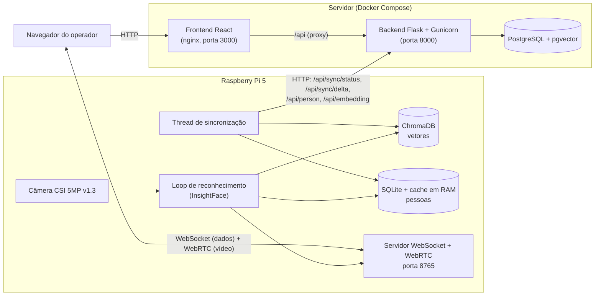

# Anotações minha

- Criar fluxo para mostrar passo a passo do funcionamento do projeto

### sobre a diversificação de threads

explicar como foi distribuida as funcionalidades em diferentes threads
explicar sobre paralelismos, concorrencia e sequencial

### anotação

antes de deligar a raspberry, verifique premeiro que não está rodando o main.py pois desligar com o código rodando pode tanto corromper os bancos de dados ChromaDB e o SQLite no momento em que tiverem fazendo escritas. e depois do código do main.py estiver interrompido, digite no terminal da raspberry 'sudo poweroff' para desligar a raspberry, então só depois do led da raspberry estiver em vermelho (indicando que a placa está apenas alimentada e com o OS não rodando) pode desligar a fonte de alimentação da raspberry

É importante monitorar a temperatura da raspberry e ter cautela no ambiente que estiver instalado pois fiz testes em uma ambiente em torno de 25°C a raspberry chegou em 74°C no qual é recomendado uma temperatura segura de até 80°C mais do que isso a própria raspberry como reduzir a o clock para se proteger de alto aquecimento. Utilize os comando para monitoramento:

- watch -n 1 vcgencmd measure_temp # para monitorar a cada 1 segundo a temperatura da raspberry
- vcgencmd get_throttled # para descobrir se teve algum problema desde a inicializadção do boot sobre throttling (recução de clock). caso retorne '0' indica que não houve problema desde o boot, caso seja 2 ou 8 indica que houve redução de clock (throttling) para diminuir a temperatura, caso retorne 5 indica subtensão (tensão baixa) no qual a fonte não entrega corrente suficiente

Para monitorar o processamento da CPU (sendo processamento entre os 4 cores da raspberry e o processamento da memória RAM) escreva no terminal 'htop'

Contém o código em network_monitor que é usado para mostrar o rede wifi se foi conectada ou não (quando a rede wifi fica em estado 'up' indicada que está conectado), perda de conexão da rede wifi, ip da raspberry conectada ao roteado para ser mostrado o endereço do websockets

para configurar o código da raspberry rodar ao iniciar o boot da raspberry faço na raspberry:
sudo cp ~/Vision-Face/raspberry/vision-face.service /etc/systemd/system/
sudo systemctl daemon-reload
sudo systemctl enable --now vision-face

evite rodar o código em um terminal na ssh, pois caso perca comunicação ssh com sua rapberry, o terminal será matado juntamente com o código da raspberry rodando. então caso não queira adicionar o código da rasp ao iniciar o boot voce pode fazer na raspberry:

```bash
sudo apt install tmux
tmux new -s vision # abre uma sessão em segundo plano chamada vision
python src/main.py # roda o programa dentro da sessão

# digite: Ctrl+B e depois D no terminal para sair da sessão sem para o programa rodando dentro dela

tmux attach -t vision # volta para a sessão e você verá o código rodando como se nunca tivesse parado mesmo que o SSH tenha caido n
```

Para ver as sessões ativas: digite no terminal 'tmux ls'
Para encerrar uma sessão parando também o programa dentre dela: digite no terminal 'tmux kill-session -t vision'
Para finalizar o programa estando dentro da sessão apenas digite Ctrl+C

Com a venv ativada na raspberry é possível na raspberry usar o script clear_data para poder limpar os registros armazenados no ChromaDB e/ou sqlite via CLI:
cd ~/Projetos/Vision-Face/raspberry/src
../.venv/bin/python clear_data.py # limpa os dois, pedindo confirmação
../.venv/bin/python clear_data.py --chroma # só o ChromaDB (embeddings)
../.venv/bin/python clear_data.py --sqlite # só o SQLite
../.venv/bin/python clear_data.py --all --yes # os dois, sem perguntar

## Seleção do modelo de reconhecimento

A variável de ambiente `INSIGHTFACE_MODEL` define qual modelo do InsightFace será utilizado. As opções disponíveis são `buffalo_l`, `buffalo_m`, `buffalo_s` e `buffalo_sc`, em ordem do maior para o menor.

Ao selecionar um modelo pela primeira vez, a Raspberry baixa o pacote e o armazena em `/home/lucas/.insightface/models/<modelo>`. Por isso, nesse primeiro uso, ela precisa estar conectada a uma rede com acesso à internet. Nas execuções seguintes, o modelo já estará salvo localmente.

## Compatibilidade entre vetores

Todos os modelos usam reconhecimento treinado na base de dados WebFace600K e geram vetores (embeddings) de 512 dimensões. Porém, os vetores só podem ser comparados entre modelos que compartilham a mesma rede de reconhecimento:

| Grupo | Modelos                   | Rede de reconhecimento      |
| ----- | ------------------------- | --------------------------- |
| A     | `buffalo_l`, `buffalo_m`  | ResNet50 (`w600k_r50`)      |
| B     | `buffalo_s`, `buffalo_sc` | MobileFaceNet (`w600k_mbf`) |

Vetores de grupos diferentes são gerados por arquiteturas distintas e, por isso, ficam em espaços vetoriais diferentes. Mesmo com o mesmo número de dimensões, a similaridade por cosseno entre eles não tem significado. Ao trocar de grupo, é necessário gerar novamente os vetores das faces já cadastradas.

### Sobre o reconhecimento facial

Configuração da camera:
A camera utilizada é uma camera de 5mp com resolução máxima de 2592 (largura) × 1944 (altura) conectado a porta 0 CSI da raspberry pi 5. Foi utilizado uma resolução de 1280\*640 sendo inferior a resolução máxima. A largura e altura da resolução pode ser configurada com qualquer valor par contando que que não seja ultrapassa o valor máximo da largura (2592px) e altura (1944px), porém a própria lib da camera deve redimencionar a resolução configurada para a resolução mais próxima nativa pradronizado pela camera. As resoluções nativas são: 1920\*1080 (FPS entre 1 e 30), 2592\*1944 (FPS entre 1 e 15), 1296\*972 (FPS entre 1 e 42), 1296\*730 (FPS entre 1 e 49), 640\*480 (FPS entre 42 e 60). Portanto deve procurar usar as resoluções nativas invés de criar uma nova resolução pois caso seja configurada um resolução diferente das nativas irá ter redimencionamento e distorção do frame.
Quanto menor a resolução menor processamento terá da CPU e por consequencia um maior FPS, devido ser necessário processar menor pixels por frame, porém isso pode trazer falhas no reconhecimento facial em faces de pessoas que estejam distante da camera devido ter pouco piexel sobre a face da pessoa.
O formato da camera foi configurado com RGB888 que na imagem contem as cores em formato BGR que é o formato utilizado pelo InsightFace.
Então o tamanho da resolução da camera deve ser o mais próximo da área de detecção configurada pelo insghtFace para que desta forma economiza CPU e redimencionamento da imagem já que a imagem capturada pela camera será redimencionada de qual quer for para sua área de detecção configurada, valores de reolução maior que a área de detecção configurada no insightFace resultará em processamento da CPU atoa.

Configuração do modelo de IA de reconhecimento facial:

Usei o módulo FaceAnalysis do insightFace, no qual é um módulo que utiliza por baixo o ArcFace. No insightFace utilizei o modelo 'buffalo_l' que é um modelo pré treino para retornar embeddings de 512 dimenções de faces identificadas de uma imagem.
Eu utilizei uma área de detecção de 640\*640 no qual a imagem passada para o modelo será redimencionado para esse valor. Essa área pode ser alterada usando apenas multiplos de 32 como 128\*128,320\*320, 448\*448, 1280\*1280, portanto áreas menores resultam em menos quantidades de pixels nisso terá resultados piores em cenários que precisa detectar faces de pessoas pequenas na imagem, portanto consome muito menos processamento tendo uma valocidade de resposta muito maior. já quanto maior a área será o comportamento contrário, tendo mais piexels, resultando melhor para detecões de faces pequenas e ser muito mas lenta e maior consumo de processamento.
Para rodar as operações matemáticas desse modelo, configurei para utilizar a CPU da raspberry. Harwares que possui GPU possuem uma velocidade muito maior para rodar esse modelo já que o hardware é otmizado para calculos matematicos.

- utilizou o conector ID -1, porque e o implica?
  O id informado na função 'self.\_app.prepare(ctx_id=-1, det_size=detection_size)' indica o dispositivo em que irá executar os calculos matematicos do modelo de IA. Configurar como '-1' indica que o processamento será na CPU, e caso for configurado como 0/1/2/3 ou outro, indica o ID da GPU do dispositivo que irá executar o processamento do modelo de IA
- alterei a configuração do face analyses para apenas permitir os modulo de detecção e reconhecimento. Pois o modelo 'buffalo_l' na verdade contem 5 modelos de IA sendo: det_10g.onnx (é o modelo de detecção do rosto, serve para retornar os pontos do rosto na imagem, no projeto uso para obter o bbox e o score de detecção), w600k_r50.onnx (serve para transforma o rosto em um vetor/embedding de 512 numeros), 1k3d68.onnx (retorno 68 pontos 3D do rosto encontrada), 2d106det.onnx (retorna 106 pontos 2d do rosto) e genderage.onnx (retorna a estimativa do genero e idade através do rosto). Então com a configuração de apenas permitindo os modelos de detecção e reconheicmento, apenas irá rodar os modelos de IA det_10g.onnx (para detecção) e w600k_r50.onnx (para reconehcimento) e os demais não serão rodados, assim irá economizar processamento, pois caso isso não seja expecificado, irá rodar todos os modelos mesmo não tendo utilizadade

1. a raspberry captura o array da camera, o que significa e como funciona?
2. Envia frame capturada na camera via WEBRTC, como funciona?
3. o modelo de IA obtem as faces através de um frame da camera. Para cada face obtida, a IA (modelo buffalo_1) retorna a embedding da face (vetor numérico de 512 dimensões), o score de confiança de detecção de uma face e as coordenadas (BOX) da face na camera.
   Após obtida a embedding, ela deve ser normalizada para corrigir erros de softmax (softmax é a operação matemática utilizada no deep learning para retornar similaridade ente embedding de 0 a 1 sendo 1 similar e 0 não similar), para isso é obtido a magnetude do vetor (sendo o comprimento do vetor calculado pela raiz da soma dos quadrados dos valores do vetor) e em seguida deve dividir cada valor do vetor pela magnetude (para um vetor de 512 dimenções são 512 valores que devem ser divididos pela magnetude). Desta forma com o vetor normalizado, o comprimento do vetor tende ser igual a 1 com os valores do vetor < 1. Com o vetor normalizado é mantido intacto o angulo e direção do vetor de 512 dimenções, porém é removido seu comprimento que agora passa ser 1 desta forma no momento de ser feito a similaridade entre dois vetores, o comprimento entre eles passa a ser indiferente já que ambos são iguais (igual a 1), é feito isso devido o comprimento dos vetores carregarem caracteristicas da imagem como nitidez, iluminação, angulo da face, que não importam para reconhecimento facial. E com os vetores normalizados, para ser feito a comparação entre eles e obter a porcentagem de similaridade, é usado a técnica de similaridade por cosseno, no qual é obtido o valor do cosseno entre os vetores, e o resultado será de -1 a 1, e quanto mais próximo de 1 mais são similar as imagens.
4. envia periodicamente (a cada um segundo) via websockets o FPS calculado e o estado de sincronização da base de dados local (ChromaDB e sqlite)

## 7. Rodando o servidor com Docker (passo a passo)

**Pré-requisitos:** Docker Desktop (para rodar o servidor em container) e Git (para clonar o projeto do github).

1. **Clone o repositório**
   ```bash
   git clone <URL_DO_REPOSITORIO> Vision-Face
   cd Vision-Face
   ```
2. **Crie o `.env`** a partir do exemplo (veja a [seção 6](#6-variáveis-de-ambiente)):
   ```bash
   cp .env.example .env
   ```
3. **Edite o `.env`**:
   - Troque `POSTGRES_PASSWORD`.
   - Troque `SECRET_KEY` e `SECURITY_PASSWORD_SALT` por valores aleatórios.
   - Defina `RASPBERRY_WS_URL` com o IP da sua Raspberry, ex.: `ws://192.168.15.103:8765`.
   - Defina `API_URL` com o IP do computador/servidor onde o Docker roda, ex.: `http://192.168.15.50:8000/api` (usado pela Raspberry).
4. **Suba os containers**
   ```bash
   docker compose up --build -d
   ```
   Ordem de inicialização: o Postgres fica saudável, o backend aplica as migrations e inicia o Gunicorn, e só então o frontend sobe.
5. **Acesse**
   - Painel: <http://localhost:3000>
   - API: <http://localhost:8000/api/person/> (deve devolver uma lista JSON, possivelmente vazia)
   - Documentação Swagger: <http://localhost:8000/api/docs>

**Comandos úteis**

```bash
docker compose down                        # para e remove tudo (mantém o banco, ou seja o volume que contem os dados são mantidos)
docker compose down -v                     # para e remove tudo inclusive APAGA o banco (pois apaga o volume do postgress que armazena os dados)
docker compose up -d --build frontend      # refaz só o serviço frontend mantendo os outros serviços funcionando. '-d' seve para rodar em    segundo plano sem congelar o terminal
docker compose up                          # roda todos os serviços
docker compose logs -f frontend            # logs do nginx
```

**Portas ocupadas:** altere `FRONTEND_PORT` e `BACKEND_PORT` no `.env`. Lembre de ajustar a porta em `API_URL`.

---

## 8. Rodando a Raspberry

- Após tudo conectado na raspberry sendo o cartão microSSD, o culer ativo, a camera no conector CSI, deve ligar a raspberry que se conectará ao wifi configurado no momento de sintalação do sistema operacional.
- As próximas etapas podem ser feitar usando um monitor, teclado e mouse conectado na raspberry e utilizar o seu terminal diretamente pela raspberry ou utilizar SSH através da comunicação WIFI configurada
- Usando SSH pode ser usado a extensão Remote SSH da microsoft pelo VS CODE, após baixado a extensão basta criar uma nova conexão SSH, depois digitar o comando de conexão no meu caso: ssh lucas@pi5.local, depois disso será pedido a senha da conexão que foi salva no momento de instalação do sistema operacional da raspberry. Logo poderá fazer a conoexão tendo em vista que a raspberry e a maquina que utiliza o SSH devem estar na mesma rede wifi.
- comando para descobrir o ip da raspberry na rede: hostname -I
  O guia completo, desde a compra e montagem do hardware até a execução, está em **[raspberry/readme.md](raspberry/readme.md)**. Resumo do que você vai fazer:

1. Montar o hardware (Pi 5, câmera 5 MP v1.3 com cabo adaptador em algum conector CSI (pode ser tanto a CAM0 ou CAM1), fonte de 5V 27 W).
2. Baixar PI OS 64bits através do PI imager no cartão microSSD com SSH e Wi-Fi configurados (deve ser o mesmo WIFI usado pelo servidor para se comunicarem)
3. Inserir o cartão microSSD na raspberry e alimentar a placa.
4. Conectar por SSH, atualizar com `apt` e validar a câmera.
5. Clonar o projeto, criar o ambiente virtual e instalar as dependências.
6. Configurar o `.env` (principalmente `API_URL`) e rodar `python main.py`.

Ao subir, o log mostra o endereço para colocar no painel, por exemplo `WebSocket address: ws://192.168.15.103:8765`.

---

# Vision Face

Sistema de **reconhecimento facial em tempo real** com câmera em uma Raspberry Pi 5, cadastro centralizado de pessoas em um servidor e painel web de monitoramento.

A câmera fica na Raspberry. Ela detecta rostos, gera uma _embedding_ (vetor numérico de 512 valores que representa o rosto) e compara com as pessoas cadastradas. O resultado e o vídeo ao vivo vão direto para o navegador do operador. O cadastro de pessoas e embeddings fica no servidor, e a Raspberry mantém uma cópia local sincronizada para reconhecer rostos sem depender de internet a cada frame.

---

## Sumário

1. [Visão geral](#1-visão-geral)
2. [Arquitetura](#2-arquitetura)
3. [Tecnologias e para que cada uma serve](#3-tecnologias-e-para-que-cada-uma-serve)
4. [Estrutura do repositório](#4-estrutura-do-repositório)
5. [Como o sistema funciona (fluxos)](#5-como-o-sistema-funciona-fluxos)
6. [Variáveis de ambiente](#6-variáveis-de-ambiente)
7. [Rodando o servidor com Docker (passo a passo)](#7-rodando-o-servidor-com-docker-passo-a-passo)
8. [Rodando a Raspberry](#8-rodando-a-raspberry)
9. [Usando o painel](#9-usando-o-painel)
10. [Referência da API e do WebSocket](#10-referência-da-api-e-do-websocket)
11. [Desenvolvimento local sem Docker](#11-desenvolvimento-local-sem-docker)
12. [Problemas comuns](#12-problemas-comuns)
13. [Privacidade e uso responsável](#13-privacidade-e-uso-responsável)

---

## 1. Visão geral

| Problema                                                             | Como o projeto resolve                                                                                                     |
| -------------------------------------------------------------------- | -------------------------------------------------------------------------------------------------------------------------- |
| Reconhecer rostos na câmera em tempo quase real, em hardware pequeno | A Raspberry Pi 5 roda a detecção e o reconhecimento localmente (InsightFace + ONNX Runtime, só CPU).                       |
| Não depender da internet/servidor a cada rosto                       | A Raspberry guarda uma cópia local das pessoas (SQLite) e dos vetores (ChromaDB) e compara localmente.                     |
| Cadastrar pessoas em um só lugar                                     | O servidor (Flask + PostgreSQL com pgvector) é a fonte da verdade; a Raspberry sincroniza por **delta** (só o que mudou).  |
| Ver a câmera e os rostos no navegador, sem plugin                    | A Raspberry transmite vídeo por **WebRTC** e envia os dados por **WebSocket**; o painel React exibe tudo.                  |
| Cadastrar quem ainda não é conhecido                                 | Rostos não reconhecidos aparecem no painel com botão **Adicionar**, que atrela a embedding a uma pessoa existente ou nova. |

O painel mostra, em tempo real: vídeo da câmera com caixas nos rostos, FPS real da câmera, dados da pessoa reconhecida (nome, nascimento, idade, se é procurada e o motivo), embeddings de rostos desconhecidos e o horário da próxima sincronização da Raspberry.

---

## 2. Arquitetura



Pontos importantes:

- O **navegador conecta direto na Raspberry** (WebSocket + WebRTC). O servidor Docker não passa vídeo nem detecções; ele só entrega o site e a API de cadastro.
- A **Raspberry conecta no servidor** (HTTP) apenas para sincronizar cadastros. Se o servidor cair, o reconhecimento continua funcionando com os dados já sincronizados.
- O navegador precisa conseguir alcançar o IP da Raspberry (mesma rede local, por exemplo).

---

## 3. Tecnologias e para que cada uma serve

### Raspberry Pi (`raspberry/`)

| Tecnologia                                | Função no projeto                                                                                                                                    |
| ----------------------------------------- | ---------------------------------------------------------------------------------------------------------------------------------------------------- |
| **Raspberry Pi 5 (8 GB) + Pi OS 64 bits** | Hardware e sistema que rodam o reconhecimento facial localmente.                                                                                     |
| **Picamera2 / libcamera**                 | Captura os frames da câmera CSI.                                                                                                                     |
| **InsightFace (modelo `buffalo_l`)**      | Detecta rostos e gera a embedding de 512 valores de cada rosto.                                                                                      |
| **ONNX Runtime (CPU)**                    | Executa os modelos do InsightFace na Raspberry (sem GPU).                                                                                            |
| **ChromaDB**                              | Banco vetorial local. Busca o vetor cadastrado mais próximo (distância de cosseno) da embedding capturada.                                           |
| **SQLite + SQLAlchemy**                   | Guarda os dados das pessoas, a versão da sincronização e a fila (`outbox`) de exclusões. Um dicionário em RAM evita consultar o SQLite a cada frame. |
| **requests**                              | Cliente HTTP da sincronização com a API do servidor.                                                                                                 |
| **websockets**                            | Servidor WebSocket: envia rostos, status, FPS e estado da sincronização; troca a sinalização do WebRTC.                                              |
| **aiortc + PyAV**                         | WebRTC: transmite o vídeo da câmera ao navegador (limitado a 20 FPS).                                                                                |
| **python-dotenv**                         | Carrega o `.env` da raiz do repositório.                                                                                                             |

### Servidor (`server/`)

| Tecnologia                                | Função no projeto                                                                                         |
| ----------------------------------------- | --------------------------------------------------------------------------------------------------------- |
| **Docker Compose**                        | Sobe todo o servidor (Postgres, backend, frontend) com um comando.                                        |
| **Flask + Flask-RESTX**                   | API REST e documentação Swagger (`/api/docs`).                                                            |
| **Gunicorn**                              | Servidor de produção do Flask dentro do container.                                                        |
| **PostgreSQL + pgvector**                 | Banco principal. A extensão `pgvector` permite guardar a embedding como coluna vetorial de 512 dimensões. |
| **SQLAlchemy + Flask-Migrate (Alembic)**  | Modelos e migrations automáticas: o container aplica `flask db upgrade` ao iniciar.                       |
| **Marshmallow**                           | Serialização e validação dos dados da API.                                                                |
| **React 19 + Vite**                       | Painel web: monitoramento ao vivo e CRUD de pessoas e embeddings.                                         |
| **nginx**                                 | Serve o build do frontend e faz proxy de `/api/` para o backend (evita CORS).                             |
| **WebRTC / WebSocket (API do navegador)** | Recebe vídeo e dados direto da Raspberry.                                                                 |

### Por que sincronização por delta?

Cada alteração no backend (pessoa ou embedding inserida, alterada ou removida) gera um registro na tabela `sync_change` com um número de **versão** crescente. A Raspberry guarda a última versão aplicada e pergunta `GET /api/sync/delta/<versão>`; recebe só o que mudou depois dela. Exclusão de pessoa usa a tabela `outbox` para garantir que os vetores dela também saiam do ChromaDB, mesmo se houver falha no meio.

---

## 4. Estrutura do repositório

```
Vision-Face/
├── .env.example              # modelo de todas as variáveis de ambiente
├── docker-compose.yml        # postgres, backend, frontend
├── README.md                 # este arquivo
├── raspberry/
│   ├── readme.md             # guia completo de montagem e execução da Raspberry
│   ├── src/
│   │   ├── main.py           # ponto de entrada (inicia sync, rede e reconhecimento)
│   │   ├── ws_server.py      # WebSocket + WebRTC para o navegador
│   │   ├── network_monitor.py# loga estado do Wi-Fi e o endereço ws://IP:porta
│   │   ├── recognition/      # camera.py, face_engine.py, runner.py, video_track.py
│   │   ├── sync/             # sincronização com o backend (delta + outbox)
│   │   ├── database/         # SQLite, ChromaDB e cache em RAM
│   │   └── requirements.txt
│   └── tests/                # scripts de teste da câmera e da captura de embeddings
└── server/
    ├── backend/              # API Flask (apis/, models/, schemas/, migrations/, web/)
    ├── frontend/             # painel React/Vite + nginx.conf + Dockerfile
    └── postgres/init.sql     # habilita a extensão pgvector
```

---

## 5. Como o sistema funciona (fluxos)

### 5.1 Reconhecimento (na Raspberry)

1. `main.py` inicializa o SQLite, carrega as pessoas para o cache em RAM e inicia três atividades: **sincronização** (thread), **monitor de rede** (thread) e **loop de reconhecimento** (thread principal).
2. O loop captura um frame (1280×720) e o entrega ao WebRTC (vídeo ao vivo).
3. O InsightFace detecta os rostos e gera, para cada um, a bounding box e a embedding normalizada.
4. Rostos com score de detecção abaixo de `FACE_MIN_DETECTION_SCORE` são ignorados.
5. A embedding é buscada no ChromaDB (vizinho mais próximo, distância de cosseno). Se a distância for menor ou igual ao limite (`0.4` por padrão para cosseno, ou `FACE_MATCH_DISTANCE_THRESHOLD`), o rosto é **reconhecido** e os dados da pessoa vêm do cache em RAM. Caso contrário, é **não reconhecido**.
6. A cada frame, a Raspberry envia pelo WebSocket a mensagem `faces` com todos os rostos do frame. A cada segundo, envia `status` com FPS da câmera e estado da sincronização.

### 5.2 Sincronização (Raspberry ← servidor)

A cada `SYNC_INTERVAL_SECONDS` (30 s por padrão):

1. Processa a fila `outbox` (exclusões pendentes no ChromaDB).
2. Consulta `GET /api/sync/status` para saber a versão mais recente do servidor.
3. Se a versão local for menor, chama `GET /api/sync/delta/<versão_local>`.
4. Aplica cada mudança em ordem: pessoas vão para o SQLite e o cache em RAM; embeddings vão para o ChromaDB (buscando os vetores em `GET /api/embedding/`).
5. Atualiza a versão local e agenda a próxima sincronização.

O painel mostra "Sincronizando…" ou "Próxima sync: HH:MM:SS (em Ns)", então depois de cadastrar uma pessoa ou embedding você sabe quando a Raspberry vai passar a reconhecê-la.

### 5.3 Cadastro a partir de um rosto desconhecido

1. Um rosto não reconhecido aparece no card **Rostos identificados** com sua embedding.
2. Clique em **Adicionar**. Escolha uma pessoa existente e o ângulo (ex.: `frontal`, `diagonal`), ou clique em **Cadastrar nova pessoa**.
3. Ao cadastrar a nova pessoa, a embedding é atrelada a ela automaticamente com o ângulo informado.
4. Na próxima sincronização, a Raspberry recebe a embedding e passa a reconhecer essa pessoa.

---

## 6. Variáveis de ambiente

Existe **um único arquivo `.env`, na raiz do repositório**, usado pelo Docker Compose, pelo backend, pelo frontend (build) e pela Raspberry. Crie a partir do exemplo:

```bash
cp .env.example .env          # Linux/macOS/Raspberry
copy .env.example .env        # Windows (cmd)
```

O `.env` não vai para o Git. Variáveis já definidas no ambiente têm prioridade sobre o arquivo.

| Variável                                            | Quem usa               | Descrição                                                                                                                       |
| --------------------------------------------------- | ---------------------- | ------------------------------------------------------------------------------------------------------------------------------- |
| `POSTGRES_DB`, `POSTGRES_USER`, `POSTGRES_PASSWORD` | Postgres, backend      | Banco e credenciais. **Troque a senha.**                                                                                        |
| `POSTGRES_PORT`                                     | Docker                 | Porta publicada em `127.0.0.1` para acessar o banco com pgAdmin (padrão 5432).                                                  |
| `DATABASE_URL`                                      | Backend fora do Docker | URI do Postgres usada ao rodar o Flask localmente. No Docker o compose monta a URI com o host `postgres`.                       |
| `SECRET_KEY`, `SECURITY_PASSWORD_SALT`              | Backend                | Segredos do Flask. Use valores aleatórios longos.                                                                               |
| `BACKEND_IP`, `BACKEND_PORT`                        | Backend, Docker        | Interface e porta publicada da API (padrão `0.0.0.0` e `8000`).                                                                 |
| `ENV`                                               | Backend                | `production` usa `DATABASE_URL` (Postgres). Qualquer outro valor usa SQLite local.                                              |
| `FLASK_APP`                                         | Backend                | `main`.                                                                                                                         |
| `FRONTEND_PORT`                                     | Docker                 | Porta publicada do painel (padrão `3000`).                                                                                      |
| `RASPBERRY_WS_URL`                                  | Frontend (**build**)   | Endereço `ws://IP_DA_RASP:8765` que já vem preenchido no painel. É lido na hora do build; ao mudar, refaça o build do frontend. |
| `API_URL`                                           | Raspberry              | URL da API do backend vista pela Raspberry, ex.: `http://IP_DO_SERVIDOR:8000/api`.                                              |
| `SYNC_INTERVAL_SECONDS`                             | Raspberry              | Intervalo entre sincronizações (padrão 30).                                                                                     |
| `WEBSOCKET_HOST`, `WEBSOCKET_PORT`                  | Raspberry              | Onde o WebSocket escuta (padrão `0.0.0.0` e `8765`).                                                                            |
| `INSIGHTFACE_MODEL`                                 | Raspberry              | Pacote de modelos (padrão `buffalo_l`, com a letra "l").                                                                        |
| `FACE_MIN_DETECTION_SCORE`                          | Raspberry              | Score mínimo do detector, de 0 a 1 (padrão 0.5).                                                                                |
| `FACE_MATCH_DISTANCE_THRESHOLD`                     | Raspberry              | Distância máxima para considerar um rosto reconhecido. Vazio usa o padrão (0.4 para cosseno). Menor = mais rigoroso.            |
| `FACE_LOG_FULL_EMBEDDING`                           | Raspberry              | `true` registra o vetor completo nos logs (muito volumoso e expõe dado biométrico).                                             |

Dois endereços diferentes, não confunda:

- `API_URL` é o **servidor visto pela Raspberry**.
- `RASPBERRY_WS_URL` é a **Raspberry vista pelo navegador**.

---

## 7. Rodando o servidor com Docker (passo a passo)

**Pré-requisitos:** Docker Desktop (Windows/macOS) ou Docker Engine + Compose (Linux) e Git.

1. **Clone o repositório**
   ```bash
   git clone <URL_DO_REPOSITORIO> Vision-Face
   cd Vision-Face
   ```
2. **Crie o `.env`** a partir do exemplo (veja a [seção 6](#6-variáveis-de-ambiente)):
   ```bash
   cp .env.example .env
   ```
3. **Edite o `.env`**:
   - Troque `POSTGRES_PASSWORD` (e a mesma senha dentro de `DATABASE_URL`).
   - Troque `SECRET_KEY` e `SECURITY_PASSWORD_SALT` por valores aleatórios.
   - Defina `RASPBERRY_WS_URL` com o IP da sua Raspberry, ex.: `ws://192.168.15.103:8765`.
   - Defina `API_URL` com o IP do computador/servidor onde o Docker roda, ex.: `http://192.168.15.50:8000/api` (usado pela Raspberry).
4. **Suba os containers**
   ```bash
   docker compose up --build -d
   ```
   Ordem de inicialização: o Postgres fica saudável, o backend aplica as migrations e inicia o Gunicorn, e só então o frontend sobe.
5. **Acompanhe**
   ```bash
   docker compose ps
   docker compose logs -f backend
   ```
6. **Acesse**
   - Painel: <http://localhost:3000>
   - API: <http://localhost:8000/api/person/> (deve devolver uma lista JSON, possivelmente vazia)
   - Documentação Swagger: <http://localhost:8000/api/docs>

**Comandos úteis**

```bash
docker compose down                        # para tudo (mantém o banco)
docker compose down -v                     # para tudo e APAGA o banco
docker compose up -d --build frontend      # refaz só o frontend (necessário ao mudar RASPBERRY_WS_URL)
docker compose logs -f frontend            # logs do nginx
```

**Portas ocupadas:** altere `FRONTEND_PORT` e `BACKEND_PORT` no `.env`. Lembre de ajustar a porta em `API_URL`.

**Firewall (Windows):** para a Raspberry alcançar a API, libere a porta `8000` de entrada no Firewall do Windows para a rede privada.

---

## 8. Rodando a Raspberry

O guia completo, desde a compra e montagem do hardware até a execução, está em **[raspberry/readme.md](raspberry/readme.md)**. Resumo do que você vai fazer:

1. Montar o hardware (Pi 5, câmera 5 MP v1.3 com cabo adaptador no conector CAM0, fonte de 27 W).
2. Gravar o Raspberry Pi OS 64 bits com SSH e Wi-Fi configurados.
3. Conectar por SSH, atualizar com `apt` e validar a câmera.
4. Clonar o projeto, criar o ambiente virtual e instalar as dependências.
5. Configurar o `.env` (principalmente `API_URL`) e rodar `python main.py`.

Ao subir, o log mostra o endereço para colocar no painel, por exemplo `WebSocket address: ws://192.168.15.103:8765`.

---

## 9. Usando o painel

Acesse <http://localhost:3000>.

**Visão ao vivo**

- Campo **Endpoint da Raspberry**: já vem com o valor de `RASPBERRY_WS_URL`. Clique em **Conectar**. O botão vira **Desconectar** enquanto houver conexão.
- O vídeo aparece com caixas nos rostos (laranja = pessoa procurada, verde = demais rostos, reconhecidos ou não). O **FPS** real da câmera aparece no canto do vídeo e no rodapé do painel.
- O card **Rostos identificados** lista só os rostos que estão na câmera neste momento. Para reconhecidos, mostra nome, nascimento, idade e alerta de procurado. Para desconhecidos, mostra a embedding e o botão **Adicionar**.
- No topo, o indicador de sincronização mostra quando a Raspberry vai sincronizar de novo.

**Pessoas cadastradas**: cadastro, edição e exclusão de pessoas e das suas embeddings. Datas no formato brasileiro `dd/mm/aaaa`.

**Embeddings**: lista de todos os vetores cadastrados, com busca e edição.

---

## 10. Referência da API e do WebSocket

### API REST (`/api`)

| Método e rota                                       | Descrição                                                                 |
| --------------------------------------------------- | ------------------------------------------------------------------------- |
| `GET/POST /person/`                                 | Lista e cria pessoas.                                                     |
| `GET/PUT/DELETE /person/<id>`                       | Consulta, altera e remove uma pessoa (e suas embeddings).                 |
| `GET /embedding/`                                   | Lista todas as embeddings.                                                |
| `GET/POST /embedding/<person_id>/embeddings`        | Lista e cria embeddings de uma pessoa (vetor com exatamente 512 valores). |
| `PUT/DELETE /embedding/<person_id>/embeddings/<id>` | Altera e remove uma embedding.                                            |
| `GET /sync/status`                                  | Versão mais recente dos dados.                                            |
| `GET /sync/delta/<versão>`                          | Mudanças ocorridas depois da versão informada.                            |

A documentação interativa completa fica em `/api/docs`.

### WebSocket da Raspberry (porta 8765)

Mensagens enviadas **pela Raspberry**:

```json
{"type":"offer","sdp":{"type":"offer","sdp":"..."}}
{"type":"ice-candidate","candidate":{"candidate":"...","sdpMid":"0","sdpMLineIndex":0}}
{"type":"status","camera_online":true,"fps":12.4,
 "sync":{"syncing":false,"backend_online":true,"last_sync_at":"2026-01-01T12:00:00+00:00",
         "next_sync_at":"2026-01-01T12:00:30+00:00","next_sync_in":18.2,"interval_seconds":30}}
{"type":"faces","frame_size":{"width":1280,"height":720},"faces":[
  {"recognized":true,"person":{"id":1,"name":"Nome","date_birth":"1990-01-01","wanted":false,"reason":null},
   "embedding":[0.01,"... 512 valores"],"model":"buffalo_l",
   "box":{"x":120,"y":60,"width":180,"height":220},"distance":0.21,
   "similarity":79.0,"embedding_id":12,"angle":"diagonal"}
]}
```

Para um rosto não reconhecido, `recognized` é `false` e `person` é `null`.

- `similarity`: similaridade de cosseno (`1 − distance`) em %, entre o rosto da câmera e a embedding cadastrada **mais próxima**. Indica o nível de confiança do reconhecimento, mas **não é uma probabilidade calibrada de acerto**. Também é enviada para rostos não reconhecidos (melhor correspondência abaixo do limite).
- `embedding_id` e `angle`: embedding cadastrada que gerou o reconhecimento e o ângulo dela (`null` quando não reconhecido). O ângulo é gravado nos metadados do ChromaDB durante a sincronização; embeddings sincronizadas antes dessa versão não têm o ângulo na Raspberry, então o painel o busca pela API usando o `embedding_id`. Mensagens enviadas **pelo navegador**: `answer` (resposta WebRTC) e `ice-candidate`.

Fluxo WebRTC: o navegador abre o WebSocket, a Raspberry envia a `offer`, o navegador responde com `answer`, e os dois trocam `ice-candidate`. O vídeo passa a fluir direto por WebRTC (usa o STUN público do Google para descobrir caminhos de rede).

---

## 11. Desenvolvimento local sem Docker

**Frontend** (Node 22):

```bash
cd server/frontend
npm install
npm run dev          # http://localhost:5173, encaminha /api para http://localhost:8000
```

O proxy usa `http://localhost:<BACKEND_PORT>` (lido do `.env` da raiz; padrão 8000).

**Backend** (Python 3.13): suba o Postgres pelo Docker (`docker compose up -d postgres`), instale `server/backend/requirements.txt` em um ambiente virtual e rode a partir da pasta `server`:

```bash
flask --app backend.main:app db upgrade
flask --app backend.main:app run --port 8000
```

Use `DATABASE_URL` com host `localhost` nesse caso.

---

## 12. Problemas comuns

| Sintoma                                                | Causa provável e solução                                                                                                                                               |
| ------------------------------------------------------ | ---------------------------------------------------------------------------------------------------------------------------------------------------------------------- |
| Painel não conecta na Raspberry                        | Confira se o `main.py` está rodando e se o IP/porta do log são os mesmos do campo de endpoint. Navegador e Raspberry precisam estar na mesma rede.                     |
| O campo de endpoint abre vazio ou com endereço antigo  | `RASPBERRY_WS_URL` é lida no build: rode `docker compose up -d --build frontend`. Um endereço salvo antes fica no `localStorage` do navegador; limpe os dados do site. |
| Site em `https` não conecta em `ws://`                 | Navegadores bloqueiam `ws://` em página `https`. Use `wss://` por proxy/túnel ou acesse o painel por `http` na rede local.                                             |
| Vídeo preto, mas conectado                             | Reconecte. Verifique no log da Raspberry mensagens de WebRTC e da câmera.                                                                                              |
| Raspberry não sincroniza ("Backend offline" no painel) | `API_URL` incorreta, servidor inacessível ou firewall bloqueando a porta 8000. Teste na Raspberry: `curl http://IP_DO_SERVIDOR:8000/api/sync/status`.                  |
| Pessoa cadastrada não é reconhecida                    | Aguarde a próxima sincronização. Cadastre embeddings de ângulos diferentes. Ajuste `FACE_MATCH_DISTANCE_THRESHOLD` com cuidado.                                        |
| FPS baixo                                              | O reconhecimento roda na CPU da Raspberry; o FPS mostrado já inclui o tempo do reconhecimento. Mais rostos no frame e `det_size` maior reduzem o FPS.                  |
| Backend não sobe                                       | Veja `docker compose logs backend`. Confira se todas as variáveis obrigatórias estão no `.env`.                                                                        |

---

## 13. Privacidade e uso responsável

Embeddings faciais são **dados biométricos sensíveis**. Use somente com base legal e consentimento adequados (no Brasil, observe a LGPD), proteja o banco, não habilite `FACE_LOG_FULL_EMBEDDING` em produção e troque todas as senhas e chaves do exemplo. Identificações são automatizadas e **devem ser verificadas por uma pessoa** antes de qualquer ação.
